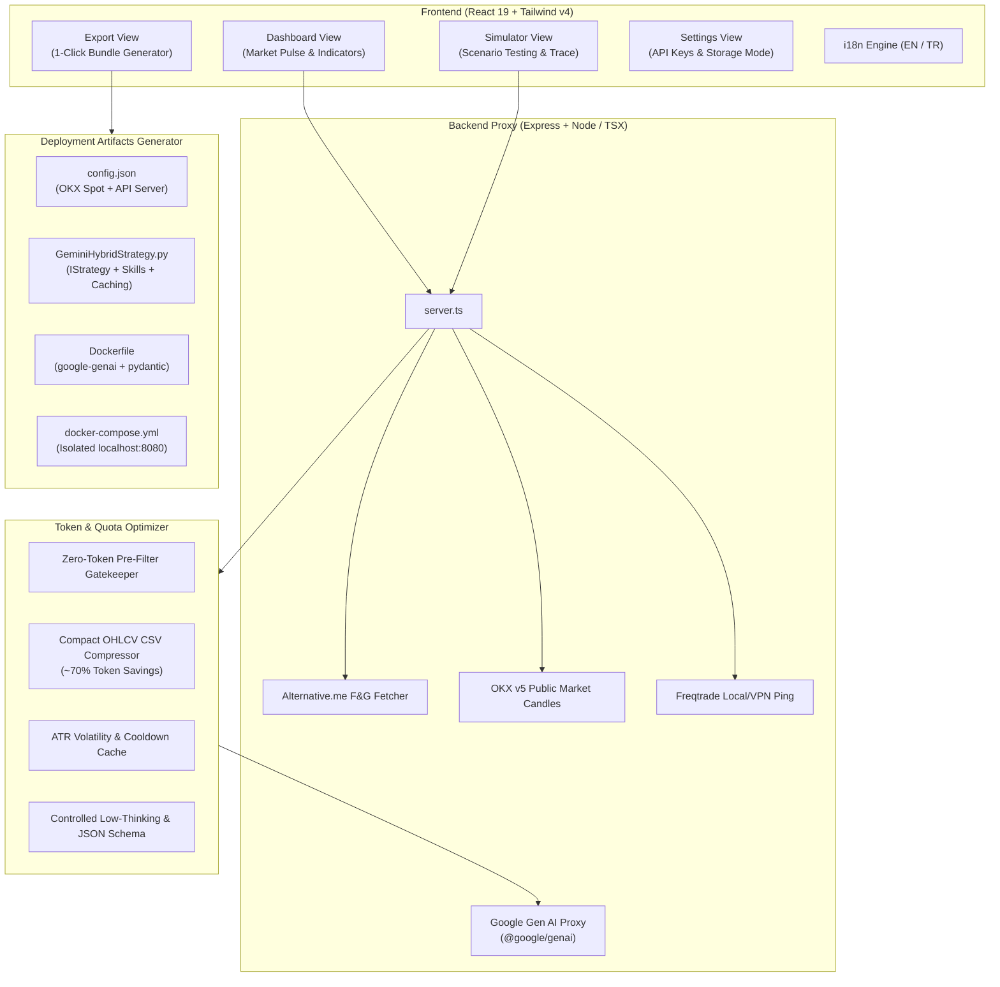

# ⚡ NexusQuant AI — Freqtrade & OKX Quantitative Control Center

[](https://www.typescriptlang.org/)
[](https://react.dev/)
[](https://tailwindcss.com/)
[](https://vitejs.dev/)
[](https://expressjs.com/)
[](https://ai.google.dev/)
[](https://www.freqtrade.io/)
[](https://www.okx.com/)
[](https://github.com/)

**NexusQuant AI** is an enterprise-grade quantitative trading companion, AI signal validation engine, and automated deployment generator built for **Freqtrade** crypto bots executing on the **OKX** spot exchange. Powered by Google's Gemini models and structured around a strict **Zero-Waste Token Optimization Architecture**, it bridges the gap between classic algorithmic technical indicators and multi-modal AI reasoning.

---

## 📑 Table of Contents

- [Architectural Overview](#-architectural-overview)
- [Key Features](#-key-features)
- [Token & Quota Optimization Architecture](#-token--quota-optimization-architecture)
- [Modular Agent Skills (Function Calling)](#-modular-agent-skills-function-calling)
- [Codebase Knowledge Graph (`/graphify` Analysis)](#-codebase-knowledge-graph-graphify-analysis)
- [Project Structure](#-project-structure)
- [Quick Start & Installation](#-quick-start--installation)
- [Environment Configuration](#-environment-configuration)
- [Freqtrade & Docker Deployment Guide](#-freqtrade--docker-deployment-guide)
- [API Endpoints Reference](#-api-endpoints-reference)
- [Security & Risk Disclaimer](#-security--risk-disclaimer)

---

## 🏛 Architectural Overview



---

## ✨ Key Features

1. **Live Real-Time Market Pulse**:
   - Streamlined live crypto market monitoring for **BTC/USDT**, **ETH/USDT**, and **SOL/USDT** via OKX v5 REST API.
   - Live **Crypto Fear & Greed Index** integration with automatic fallback heuristics.
   - Built-in lightweight RSI calculation across active pairs.

2. **AI Signal Simulator & Multi-Turn Verification**:
   - Realistic market scenario emulation: *Oversold Long*, *Overbought Short*, *Idle Neutral*, and *Live OKX Data*.
   - Live function trace inspection showing model tool-calling invocations, arguments, and return payloads.
   - Localized reasoning and trade journal entries in **English** or **Türkçe**.

3. **1-Click Freqtrade + Docker Generator**:
   - Instant generation of `GeminiHybridStrategy.py`, `config.json`, `Dockerfile`, and `docker-compose.yml`.
   - In-browser ZIP bundling via `JSZip` with file preview, syntax inspection, and clipboard copying.

4. **Security & Zero-Leakage Architecture**:
   - Dual client-side storage modes: `localStorage` or ephemeral `sessionStorage` (with in-memory fallback).
   - Passwords and private keys masked with toggleable visibility.
   - Strict `127.0.0.1` Docker host bindings preventing public exposure of the Freqtrade API.

5. **Complete Bilingual Support (EN / TR)**:
   - Instant language switching across all navigation tabs, indicator controls, error diagnostics, and AI journal entries.

---

## ⚡ Token & Quota Optimization Architecture

One of the central design challenges of AI-assisted quantitative trading is high API latency, token consumption, and rate limits. NexusQuant AI implements a **4-Layer Optimization System**:

| Layer | Mechanism | Implementation Detail | Token / Cost Impact |
| :--- | :--- | :--- | :--- |
| **Layer 1** | **Zero-Token Pre-Filter Gatekeeper** | Local Python strategy evaluates RSI, EMA spans, and volume before engaging the AI. If market conditions are neutral, Gemini is never called. | **Eliminates 80–95%** of API requests during chop/idle markets. |
| **Layer 2** | **Compact OHLCV CSV Serialization** | Replaces verbose JSON objects (`[{"t":..., "o":..., "h":...}]`) with newline-delimited, precision-rounded CSV rows (`t,o,h,l,c,v`) with epoch timestamps divided by 60. | **~70% prompt token reduction** per candle batch. |
| **Layer 3** | **ATR Volatility & Cooldown Cache** | Per-pair cached decisions with configurable TTL (e.g., 10m). If the price ATR volatility shift is below `atrCacheDeltaPct`, previous signal decision is reused. | **Prevents duplicate evaluations** on consecutive candles. |
| **Layer 4** | **Schema Enforcement & Low Thinking** | Explicit `responseMimeType: "application/json"`, strict `responseSchema`, and `thinkingLevel: LOW` guarantee single-turn, zero-parse-error JSON output. | **Eliminates JSON parsing errors** and reduces output tokens to <120 tokens. |

---

## 🧠 Modular Agent Skills (Function Calling)

NexusQuant AI provides four optional, modular tool capabilities exposed as Gemini `FunctionDeclaration` definitions:

1. `fetch_sentiment_and_fear_greed`:
   - Fetches live market sentiment ratings and CryptoPanic news headlines for the base asset.
2. `check_multi_timeframe_trend`:
   - Inspects higher timeframe (1H and 4H) EMA slope alignment before confirming lower timeframe (5m/15m) entries.
3. `calculate_dynamic_position_size`:
   - Computes dynamic USDT stake multipliers (0.25x – 1.25x) based on AI confidence score and ATR volatility regime.
4. `post_trade_journal_summary`:
   - Generates a concise, localized 1-sentence trade post-mortem and rationale for the bot audit log.

---

## 🔍 Codebase Knowledge Graph (`/graphify` Analysis)

This codebase was audited and indexed using [`/graphify`](https://github.com/) to build a structural and semantic knowledge graph.

### Graph Metrics
- **Total Nodes**: 165
- **Total Edges**: 383
- **Extraction Fidelity**: 100% EXTRACTED (deterministic AST extraction, 0 tokens consumed)
- **Detected Communities**: 7 clusters
- **Interactive Visualization**: [`graphify-out/graph.html`](file:///d:/Documents/agy/NexusQuant-AI/graphify-out/graph.html)
- **Detailed Audit Report**: [`graphify-out/GRAPH_REPORT.md`](file:///d:/Documents/agy/NexusQuant-AI/graphify-out/GRAPH_REPORT.md)

### Architectural Clusters (Communities)
1. **Community 0 — UI Components, Types & i18n**: Core presentation layer (`DashboardView`, `SimulatorView`, `SettingsView`, `Sidebar`, `TopBar`, `types.ts`, `translations.ts`).
2. **Community 1 — App State & Storage Management**: Central React container (`App.tsx`), storage adapters (`localStorage`/`sessionStorage`), default configuration constants.
3. **Community 2 — Backend Server & Gemini AI Engine**: Express proxy (`server.ts`), OKX REST connector, Alternative.me API client, `@google/genai` integration.
4. **Community 3 — Build Tooling & Styling Dependencies**: Vite, Tailwind CSS v4, Motion, PostCSS, TypeScript typings.
5. **Community 4 — TypeScript Configuration**: Strict `tsconfig.json` compiler options, ESNext module resolution, path aliases.
6. **Community 5 — Freqtrade & Docker Code Generators**: Template synthesizers (`generateStrategyPy`, `generateConfigJson`, `generateDockerfile`, `generateDockerCompose`, `JSZip`).
7. **Community 6 — NPM Scripts & Lifecycle Commands**: Build, development, clean, preview, and typecheck scripts.

### Core Abstractions ("God Nodes")
The highest-centrality nodes coordinating the architecture:
- `App()` (23 edges) — Central application coordinator.
- `Language` & `getT()` (30 edges combined) — High-throughput internationalization bridge.
- `ApiSettings` (16 edges) — Centralized credentials and connection state contract.
- `StrategyConfig` & `TokenOptimizationConfig` (22 edges combined) — Algorithmic control and token budget parameters.

---

## 📁 Project Structure

```text
NexusQuant-AI/
├── graphify-out/               # Graphify AST Knowledge Graph & Interactive Visualization
│   ├── graph.html              # Interactive HTML network visualization
│   ├── graph.json              # GraphRAG-ready node/edge database
│   └── GRAPH_REPORT.md         # Comprehensive graph audit & metrics
├── src/
│   ├── components/             # React View Components
│   │   ├── DashboardView.tsx   # Market pulse, indicators & strategy configuration
│   │   ├── ExportView.tsx      # Code preview & ZIP deployment exporter
│   │   ├── SettingsView.tsx    # API keys, connections & storage mode
│   │   ├── Sidebar.tsx         # Navigation drawer
│   │   ├── SimulatorView.tsx   # AI trade simulator & tool-calling trace
│   │   └── TopBar.tsx          # Status indicators & language selector
│   ├── i18n/
│   │   └── translations.ts     # Bilingual (EN / TR) localization dictionaries
│   ├── utils/
│   │   ├── generators.ts       # Freqtrade Python & Docker template engines
│   │   └── storage.ts          # Safe storage persistence adapter
│   ├── App.tsx                 # Root application state & tab router
│   ├── index.css               # Tailwind CSS v4 design tokens & theme
│   ├── main.tsx                # React DOM root entrypoint
│   └── types.ts                # TypeScript interfaces and domain models
├── .env.example                # Sample environment variables
├── index.html                  # Web application entry template
├── metadata.json               # Application capabilities manifest
├── package.json                # Dependencies and npm run scripts
├── server.ts                   # Express server, Gemini proxy & OKX candles
├── tsconfig.json               # Strict TypeScript compiler options
└── vite.config.ts              # Vite configuration with React & Tailwind plugins
```

---

## 🚀 Quick Start & Installation

### Prerequisites
- [Node.js](https://nodejs.org/) (v20+) or [Bun](https://bun.sh/)
- A [Google Gemini API Key](https://aistudio.google.com/)
- (Optional) [OKX Exchange Account](https://www.okx.com/) with API Key for trading
- (Optional) [Docker & Docker Compose](https://www.docker.com/) for deploying Freqtrade

### 1. Clone the Repository
```bash
git clone https://github.com/your-username/NexusQuant-AI.git
cd NexusQuant-AI
```

### 2. Install Dependencies
```bash
npm install
# or
bun install
```

### 3. Configure Environment
Copy the example environment file:
```bash
cp .env.example .env
```
Edit `.env` and provide your Gemini API key:
```env
GEMINI_API_KEY=your_gemini_api_key_here
PORT=3000
```

### 4. Run Development Server
```bash
npm run dev
```
Open your browser at [http://localhost:3000](http://localhost:3000).

---

## ⚙ Environment Configuration

| Variable | Description | Required | Default |
| :--- | :--- | :--- | :--- |
| `GEMINI_API_KEY` | Google Gemini API Key used for signal validation | **Yes** | — |
| `PORT` | Local server port | No | `3000` |
| `NODE_ENV` | Environment mode (`development` / `production`) | No | `development` |
| `OKX_API_KEY` | OKX API Key (optional for server; configured in UI) | No | — |
| `OKX_SECRET_KEY` | OKX Secret Key | No | — |
| `OKX_PASSPHRASE` | OKX API Passphrase | No | — |
| `CRYPTOPANIC_API_KEY` | Optional token for news headlines sentiment | No | — |

---

## 🐳 Freqtrade & Docker Deployment Guide

NexusQuant AI allows you to download a complete, plug-and-play Freqtrade bot deployment:

1. Navigate to the **Export (Dışa Aktar)** tab in the UI.
2. Review the generated files:
   - `GeminiHybridStrategy.py`
   - `config.json`
   - `Dockerfile`
   - `docker-compose.yml`
3. Click **Download ZIP Bundle** (or copy individual code blocks).
4. Unpack the files on your server:
   ```bash
   mkdir -p freqtrade_bot/user_data/strategies
   cd freqtrade_bot
   # Place GeminiHybridStrategy.py in user_data/strategies/
   # Place config.json in user_data/
   # Place Dockerfile and docker-compose.yml in the root
   ```
5. Build and launch with Docker Compose:
   ```bash
   docker compose up -d --build
   ```
6. Monitor bot activity and AI decisions:
   ```bash
   docker compose logs -f freqtrade
   ```

---

## 📡 API Endpoints Reference

The backend proxy (`server.ts`) exposes the following endpoints:

### `GET /api/market-pulse`
Returns live market data, Fear & Greed index, RSI, and compact CSV candles for BTC, ETH, and SOL.
- **Response**:
  ```json
  {
    "fearGreed": { "value": 58, "classification": "Greed", "source": "live" },
    "pairs": {
      "BTC/USDT": { "price": 91450.2, "changePct": 1.45, "rsi": 28.4, "compactCsv": "..." }
    },
    "fetchedAt": "2026-11-13T15:30:00.000Z"
  }
  ```

### `POST /api/test-connection`
Tests connectivity and credentials for Gemini, OKX, and Freqtrade REST API.
- **Request Body**:
  ```json
  {
    "geminiApiKey": "...",
    "okxApiKey": "...",
    "freqtradeUrl": "http://127.0.0.1:8080"
  }
  ```

### `POST /api/gemini/simulate`
Simulates signal evaluation using Gemini with active function declarations and token measurement.
- **Request Body**: `SimulateRequestBody` (pair, indicators, feeds, enabled skills, custom keys).
- **Response**: Contains the normalized decision (`BUY` / `SELL` / `HOLD`), confidence score, position multiplier, localized rationale, tool invocation trace, and payload savings statistics.

---

## 🛡 Security & Risk Disclaimer

> [!CAUTION]
> **Cryptocurrency trading involves substantial risk of loss.**
> - NexusQuant AI is designed as a technical signal validation and deployment tool. No trading strategy guarantees profits.
> - **Dry-Run First**: Always thoroughly test strategies in dry-run mode (`tradingMode: 'dry_run'`) before committing capital to live trading.
> - **API Credentials**: Never share your OKX API Secret Key or Passphrase. Ensure IP whitelisting is enabled on your OKX API key settings.
> - **Network Security**: The generated Docker Compose configuration strictly binds the Freqtrade API port to `127.0.0.1:8080`. Do not expose this port directly to the public internet.

---

## 📄 License

This project is licensed under the MIT License — see the [LICENSE](LICENSE) file for details.
